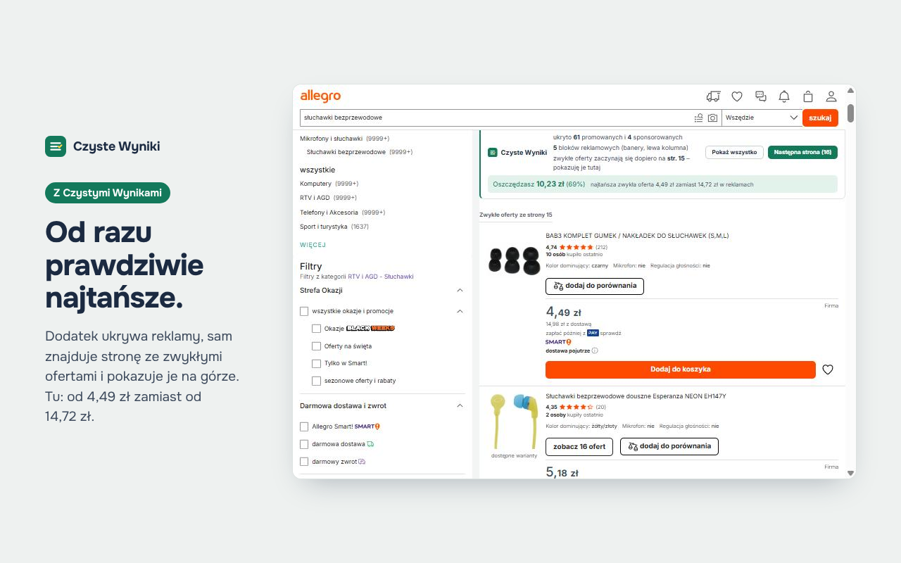
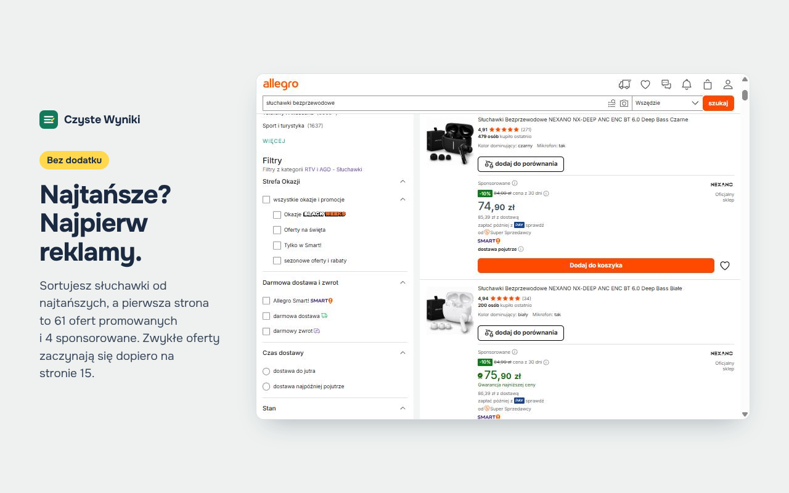

# 🧹 Czyste Wyniki – bez promowanych ofert na Allegro



**Instalacja:** Firefox – addons.mozilla.org (wkrótce) · Chrome – Chrome Web Store (wkrótce) · albo ręcznie, patrz niżej.

Rozszerzenie do Firefoksa i Chrome, które przywraca sens sortowaniu „cena: od najniższej” na Allegro.

## Problem

Gdy sortujesz wyniki Allegro od najtańszych, najpierw dostajesz **setki ofert promowanych**
(posortowanych po cenie tylko między sobą). Zwykłe oferty, często dużo tańsze, zaczynają się
dopiero na dalekiej stronie.

Przykład (listopad 2026, „słuchawki bezprzewodowe”, od najtańszych):

| | Allegro | Czyste Wyniki |
|---|---|---|
| Pierwsza strona | 61 promowanych, 4 sponsorowane, 1 zwykła | same zwykłe oferty |
| Najtańsza oferta na górze | ok. 19 zł | **4,49 zł** |
| Gdzie są zwykłe oferty | od strony **15** | od razu na stronie 1 |

## Co robi

- Ukrywa oferty **promowane** i **sponsorowane**, przyciemnia je z podpisem albo, w trybie
  **uczciwego sortowania**, zostawia je, ale układa razem ze zwykłymi ofertami ściśle po cenie
  (reklamy dostają żółtą ramkę).
- Sam szuka strony, od której zaczynają się zwykłe oferty, i pokazuje je od razu na górze.
  Szukanie trwa kilka sekund i zajmuje do 10 zapytań; wynik jest zapamiętywany w karcie.
- **Sortuje po cenie z dostawą**: oferta za 4,49 zł z dostawą 14,98 zł spada za tę za 5,74 zł z dostawą 10,23 zł.
- **Licznik oszczędności**: „Najtańsza zwykła oferta 4,49 zł · najtańsza promowana 14,72 zł · oszczędzasz 10,23 zł (69%)”.
- **Filtr fraz**: ukrywa oferty, których tytuł zawiera wpisane słowa (np. „gumki, etui, nakładki”).
  Uwzględnia odmianę: „gumki” ukryje też „gumek”. Dokładny tekst wpisuje się w cudzysłowie.
- **Filtr czasu dostawy**: ukrywa oferty z dostawą dłuższą niż np. 3 dni (zwykle wysyłka z Chin).
- **Filtr ocen**: ukrywa oferty z oceną produktu poniżej np. 4,5 ★ albo z mniej niż 10 ocenami.
- **Cena za kg / l / szt.**: wyczytuje ilość z tytułu („4 x 500 ml”, „500 g”, „10 szt.”), dopisuje
  cenę za jednostkę na karcie (gdy Allegro samo jej nie podaje) i pozwala po niej sortować.
- **Bloki reklamowe**: ukrywa banery sponsorowane z ofertami (u góry i na dole wyników), kolumnę
  „Sponsorowane” po lewej, reklamy wideo i karuzele reklam w środku wyników.
- **Mniej śmieci**: ukrywa „Rekomendacje dla Ciebie” i artykuły poradnikowe.
- **Licznik na ikonie**: plakietka z liczbą ukrytych ofert na bieżącej stronie.
- W kategoriach, gdzie Allegro miesza reklamy ze zwykłymi ofertami (po kilka zwykłych na stronę),
  **zbiera zwykłe oferty z kolejnych stron** (do 6). Gdy nie znajdzie żadnej, pokazuje reklamy
  przyciemnione zamiast pustej strony.
- Dociąga kolejne strony zwykłych ofert. Link „Dalej” pomija strony, które już widziałeś.
- Przycisk „Pokaż wszystko” na pasku chwilowo pokazuje stronę tak, jak ją ułożyło Allegro.
- Wszystko działa lokalnie. Dodatek łączy się tylko z allegro.pl i niczego nie zbiera.

## Zrzuty ekranu

| Bez dodatku | Z dodatkiem | Ustawienia |
|---|---|---|
|  |  |  |

## Instalacja ręczna (tryb deweloperski)

**Firefox:** wejdź na `about:debugging#/runtime/this-firefox` → „Wczytaj tymczasowy dodatek…”
→ wybierz plik `manifest.json` (albo plik `.zip`).

**Chrome / Edge / Brave / Opera:** wejdź na `chrome://extensions` → włącz „Tryb dewelopera”
→ „Wczytaj rozpakowane” → wskaż folder z plikiem `manifest.json`.

## Gdy Allegro zmieni wygląd strony

Wszystko, co zależy od wyglądu Allegro, jest w jednym pliku: `src/selectors.js`.
Dodatek nie korzysta z losowych klas CSS Allegro. Rozpoznaje oferty po etykietach
„Promowane” i „Sponsorowane” (aria-label) oraz po strukturze `ul > li > article`.

## Struktura

```
manifest.json        – Manifest V3 (Firefox 140+ i Chrome 121+)
src/selectors.js     – selektory i limity
src/content.js       – logika na stronie Allegro
src/content.css      – wygląd paska i ukrywania
src/background.js    – licznik na ikonie dodatku
popup/               – okienko ustawień (paragon z podsumowaniem, zakładki Reklamy / Ceny / Filtry)
popup/fonts/         – czcionka Onest (licencja SIL OFL 1.1)
icons/               – ikony
```

## Znane ograniczenia

- Dociągnięte karty to kopie: przyciski „Dodaj do koszyka” i „ulubione” otwierają stronę oferty.
- Sortowanie po cenie to sortowanie Allegro. Na górze mogą być akcesoria (np. gumki do słuchawek),
  bo są po prostu najtańsze.
- Czarnej listy sprzedawców nie ma, bo karty w wynikach Allegro nie pokazują nazwy sprzedawcy.
- Cena za jednostkę działa tylko, gdy ilość jest w tytule oferty. Przy sortowaniu po niej porównywane
  są oferty z tą samą jednostką (najczęstszą na liście), reszta trafia na koniec.
- Allegro może ograniczyć liczbę zapytań. Gdy wykryje stronę weryfikacji, dodatek przestaje dociągać oferty.

Projekt nie jest powiązany z Allegro.

## Licencja

Kod: MIT (plik `LICENSE`). Czcionka Onest: SIL Open Font License 1.1 (`popup/fonts/LICENSE-Onest.txt`).
